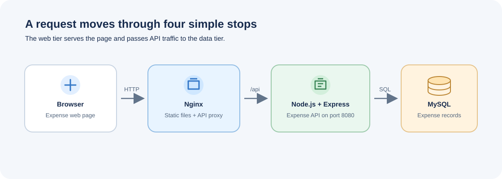

# Expense Tracker

This project uses a three-tier setup to record and display expenses. The browser loads the web page from Nginx, Nginx forwards API requests to the Node.js service, and the service reads and writes data in MySQL.

## Architecture

Nginx serves the frontend and forwards API requests to the Node.js backend. The backend reads and writes expense records in MySQL.

## Project files

- `expense-frontend-v2.zip` contains the ready-to-serve frontend files.
- `expense-backend-v2.zip` contains the Node.js API and its MySQL schema.
- `mysql.MD`, `backend.MD`, and `frontend.MD` describe database, API, and web-tier setup, in that order.
