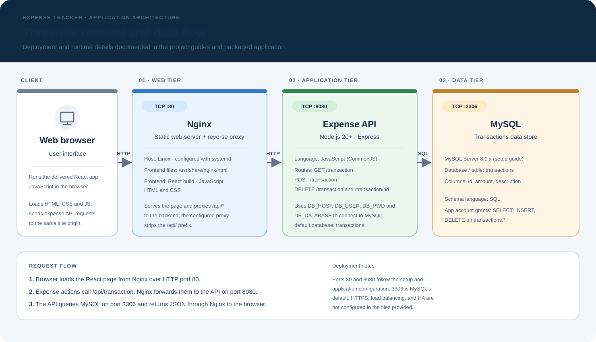

# Expense Tracker

Expense Tracker is a  three-tier web application for recording, listing, and deleting expense transactions. A browser loads the web interface from Nginx, Nginx forwards API requests to a Node.js service, and that service stores data in MySQL.

## Architecture and technologies

| Tier | Component | Language / technology | Responsibility |
| --- | --- | --- | --- |
| Web | Nginx serving a prebuilt React frontend | React and JavaScript in the browser; HTML and CSS assets | Serves the user interface and proxies `/api/*` requests to the backend. |
| Application | Node.js 20+ and Express | JavaScript (CommonJS) | Validates requests and reads, creates, or deletes transactions. |
| Data | MySQL Server 8.0.x | MySQL; schema defined in SQL | Stores transaction IDs, amounts, and descriptions in the `transactions` table. |

The setup guides describe running the tiers on Linux hosts. The files in this repository do not define a cloud network, load balancer, TLS certificate, or high-availability deployment.

## Ports and request flow

| Source | Destination | Port | Purpose |
| --- | --- | --- | --- |
| Browser | Nginx | TCP 80 (HTTP) | Loads the frontend and sends same-origin API requests. |
| Nginx | Node.js / Express | TCP 8080 (HTTP) | Proxies `/api/*` to the backend. The example Nginx configuration removes the `/api/` prefix, so `/api/transaction` reaches the backend as `/transaction`. |
| Node.js / Express | MySQL | TCP 3306 | Reads and writes transaction records. This is MySQL's default port; the backend database configuration does not override it. |

The backend listens on port `8080` by default; set `PORT` to change it. Configure Nginx to use the backend host address instead of `localhost` when the two services run on separate hosts. The documented setup uses HTTP and does not configure HTTPS.

## What the application does

The browser UI supports adding expenses, viewing the transaction list, deleting one expense, and deleting all expenses. Requests go through the Nginx proxy:

| Method | Browser URL | Behavior |
| --- | --- | --- |
| `GET` | `/api/transaction` | Lists transactions. |
| `POST` | `/api/transaction` | Adds a transaction using `amount` and `desc` in the JSON body. |
| `DELETE` | `/api/transaction` | Deletes all transactions. |
| `DELETE` | `/api/transaction/:id` | Deletes the transaction with that ID. |
| `GET` | `/api/transaction/id?id=<id>` | Looks up one transaction by ID. |

The API also exposes `GET /health`. The frontend guide configures Nginx's `/health` location for Nginx status, so use the backend directly on port `8080` to reach the API health route in that deployment.

## Run and deploy

The project is supplied as deployment archives rather than a complete frontend source tree:

- `expense-frontend-v2.zip` contains the built static React site. Extract its contents into the Nginx document root (the guide uses `/usr/share/nginx/html`).
- `expense-backend-v2.zip` contains the Node.js API, its `package.json`, and the SQL schema.

To deploy on Linux, follow the guides in order:

1. [01-mysql.MD](01-mysql.MD) — install and start MySQL.
2. [02-backend.MD](02-backend.MD) — install Node.js, configure and start the API, and load `schema/backend.sql` into the database server.
3. [03-frontend.MD](03-frontend.MD) — install Nginx, publish the frontend archive, configure the API proxy, and start Nginx.

The backend requires Node.js 20 or later. Its database settings are read from `DB_HOST`, `DB_USER`, `DB_PWD`, and `DB_DATABASE`; `DB_USER` defaults to `expense` and `DB_DATABASE` defaults to `transactions`. Set `DB_PWD` to the password for the application account created by the SQL schema. If you change that account's password, update the backend environment as well. Keep real credentials out of source control.

When running the API manually from the extracted backend directory, install its dependencies with `npm install` and start it with `npm start` (or `node index.js`). The deployment guide uses systemd to run the service.

## Project files

- `3-tier-expense.svg` — architecture diagram, including tiers, languages, and ports.
- `01-mysql.MD`, `02-backend.MD`, `03-frontend.MD` — deployment instructions for each tier.
- `expense-backend-v2.zip`, `expense-frontend-v2.zip` — packaged backend and prebuilt frontend.
